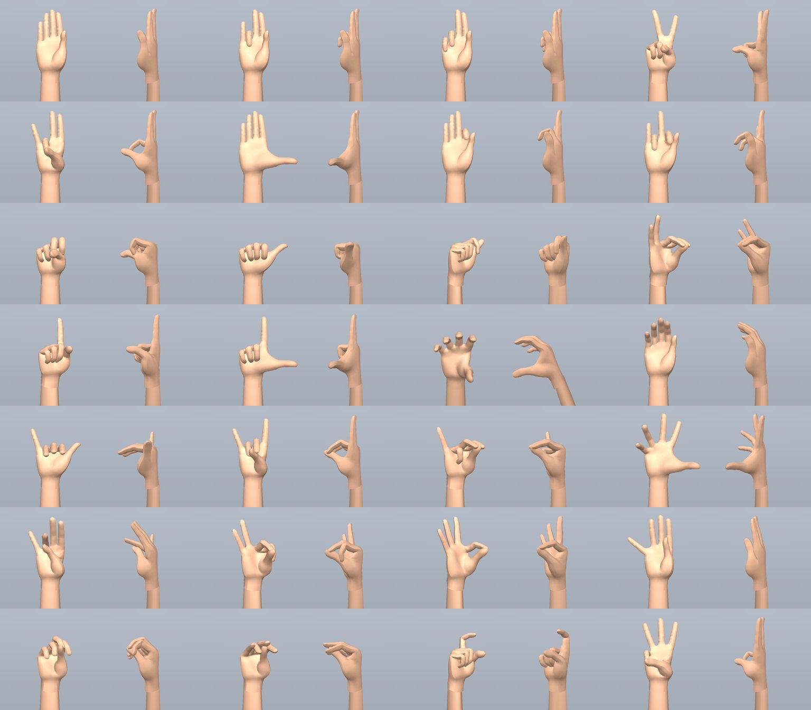
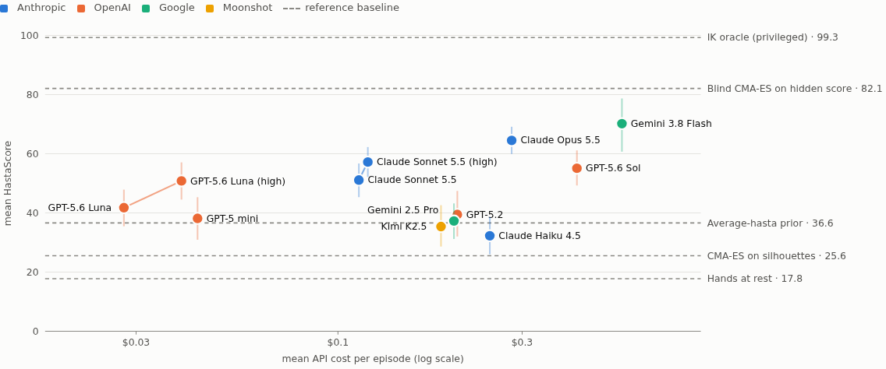
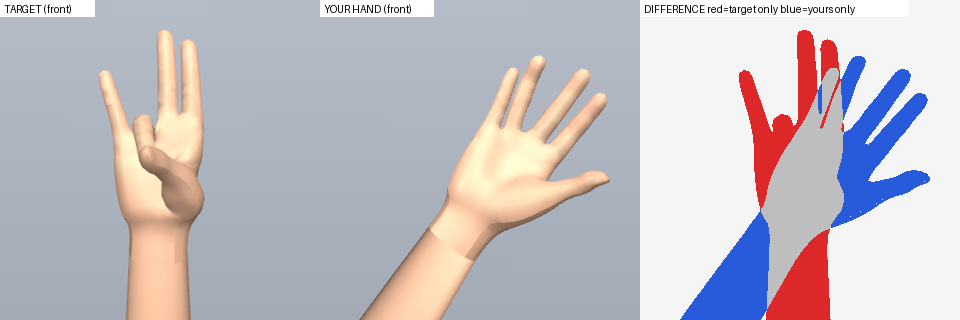

# HastaBench

**Can frontier vision-language models form the hand gestures of classical Indian dance with an articulated 3-D hand?**

HastaBench is a benchmark and RL-ready environment built around the *hastas* (mudras) of Bharatanatyam as defined in the *Abhinaya Darpana*. A model sees reference renders of a target gesture and poses a physically simulated, 21-joint human hand one tool call at a time. It never sees its score. Every call is logged together with the hand state and a hidden score, so each episode can be replayed exactly.

<p align="center"><br><em>The 28 single-hand (asamyuta) targets, front and side views.</em></p>

The interactive report, **[samarth777.github.io/hastabench](https://samarth777.github.io/hastabench/)** (source: [`site/index.html`](site/index.html)), covers the leaderboard, every final pose, per-call score curves, failure analysis and a three.js replay of every episode. Clone the repo and open the file directly; no server is needed.

## Results (v1)

One episode per hasta from the same seeded start pose (seed 0), default reasoning effort unless noted. The score is a mean HastaScore (0–100) with a 95% bootstrap interval over hastas. "Solved" means the strict success test passes (see [Scoring](#scoring)). Cost is the mean API cost per episode at the serving proxy's per-token prices, including cache reads.

| Model | Score | 95% CI | Solved | $/episode |
|---|---:|---:|---:|---:|
| Gemini 3.8 Flash | **70.2** | 60.7–78.7 | **13/28** | 0.544 |
| Claude Opus 5.5 | 64.5 | 59.9–69.1 | 4/28 | 0.282 |
| Claude Sonnet 5.5 (high effort) | 57.2 | 52.2–62.3 | 2/28 | 0.120 |
| GPT-5.6 Sol | 55.1 | 49.3–61.1 | 2/28 | 0.416 |
| Claude Sonnet 5.5 | 51.1 | 45.3–56.7 | 0/28 | 0.113 |
| GPT-5.6 Luna (high effort) | 50.8 | 44.5–57.1 | 2/28 | 0.039 |
| GPT-5.6 Luna | 41.8 | 35.5–47.9 | 0/28 | 0.028 |
| GPT-5.2 | 39.5 | 32.0–47.4 | 2/28 | 0.204 |
| GPT-5 mini | 38.2 | 30.9–45.3 | 0/28 | 0.043 |
| Gemini 2.5 Pro | 37.3 | 31.2–43.2 | 0/28 | 0.200 |
| Kimi K2.5 | 35.4 | 28.7–42.6 | 0/28 | 0.185 |
| Claude Haiku 4.5 | 32.3 | 26.0–38.6 | 1/28 | 0.247 |
| *IK oracle (privileged)* | *99.3* | | *28/28* | |
| *Blind CMA-ES on the hidden score (2,000 poses)* | *82.1* | | *16/28* | |
| *Average-hasta prior (featureless, given the orientation)* | *36.6* | | *0/28* | |
| *CMA-ES on image silhouettes (2,000 poses)* | *25.6* | | *0/28* | |
| *Hands at rest (start pose)* | *17.8* | | *0/28* | |

<p align="center"></p>

**Main observations** (v1.1 targets; details in the report):
* No model is reliable. The best solves 13 of 28 hastas, and 13 hastas are solved by no model at default effort.
* The targets are reachable within the rules: a blind search that may query the hidden score solves 16. A search guided only by silhouettes does worse than every model, so the models are using the images.
* Moves are poorly aimed. Of 6,001 accepted moves, 41% raised the hidden score and 32% lowered it. In 193 of 280 episodes the submitted pose scored more than 2 points below the episode's best.
* The thumb is the bottleneck: 81% of unsolved episodes miss with the thumb by more than 2 cm, and 69% fail a required contact.
* Models rarely identify the gesture (64 of 280 plans name it) and rarely read its classical description (16 episodes), although a read costs only 6% of the score.
* Two-hand (samyuta) gestures are much harder: the best model averages 41.9 and no episode is solved (the privileged oracle reaches 84.4).
* High reasoning effort helps somewhat: +6.1 for Sonnet 5.5 and +9.0 for GPT-5.6 Luna.
* Correcting the targets (v1.0 → v1.1) left the ranking almost unchanged; see `results/archive/` for the v1.0 run.

## Benchmark protocol

| | |
|---|---|
| Hand | WebXR *generic-hand* skin (MIT) driven by linear-blend skinning from a MuJoCo kinematic tree derived from the mesh's skeleton. 21 finger DOF (thumb CMC flex/abd/twist, MCP, IP; per finger abd, MCP, PIP, DIP) plus 6 root DOF, all with position servos. Each call is followed by 0.3 s of physics with self-collision (capsules and a palm box fitted to the mesh) |
| Observation | Target renders (front + three-quarter; front + top for two hands) and a start render. `look(camera)` returns `[target | current | silhouette difference]` from one of 5 cameras |
| Tools | `plan` (required before the first move), `set_fingers` (batched absolute angles for one hand), `turn_hand`, `move_hand`, `undo`, `describe` (numbers), `look`, `read_description` (classical text; final score × 0.94 per read), `submit` |
| Budget | 60 calls, at most 20 looks and 2 reads. The pose is submitted automatically when the budget runs out |
| Rules | Per call: ≤ 45° per joint, ≤ 45° per rotation axis, ≤ 10 cm per translation axis. Out-of-range or over-limit calls are **refused**: the call is spent and the pose is unchanged. Fingers that collide stop at the contact ("blocked by contact") |
| Context | Targets, the start render and the 3 most recent looks stay in context |

<p align="center"><br><em>What <code>look("front")</code> returns: target, current hand, and difference (red = target only, blue = current only).</em></p>

### Targets
Each hasta is specified in [`src/hastabench/hastas.py`](src/hastabench/hastas.py) as an *intent* pose (joint angles transcribed from the textual definition) plus explicit constraints: surfaces that must touch (e.g. ring fingertip on thumb tip) and surfaces that must stay apart. [`targets.py`](src/hastabench/targets.py) solves for the nearest configuration that meets the constraints without interpenetration, settles it physically and validates it. 28/28 single-hand targets ([`data/targets_v1`](data/targets_v1)) and 5/5 two-hand targets ([`data/samyuta_v1`](data/samyuta_v1)) pass.

**Reference-image verification (v1.1).** Every target was compared finger by finger with at least four independent references: dancer photos, dance-school charts, Wikimedia Commons, natyasutraonline.com, onlinebharatanatyam.com, and Coomaraswamy & Duggirala's *The Mirror of Gesture* (1917). Of the v1.0 targets, 4 were wrong (Mrigashirsha, Kangula, Sandamsha, Swastika) and 20 had minor deviations, mostly from a too-straight thumb in the fist hastas and loose finger spacing. All were corrected. Sandamsha is a movement (Padmakosha opening and closing), so its target is the closed moment. See [`verify/REPORT.md`](verify/REPORT.md) and the per-group files there for verdicts and source URLs. The v1.0 episode logs are kept in `results/archive/`.

> ⚠️ The targets have still **not** been reviewed by a Bharatanatyam expert, and several hastas have regional variants (each target encodes one common form). Expert review is the main open item.

### Scoring
[`scorer.py`](src/hastabench/scorer.py) compares 20 hand keypoints (MCP, PIP, DIP and tip of each finger; CMC, MCP, IP and tip of the thumb) in the hand's own frame, along with the hand's orientation and the gesture's contact constraints:

```
HastaScore = 100 · [0.6·exp(−ē / 15 mm) + 0.2·max(0, 1 − θ / 45°) + 0.2·c] · v · 0.94^reads
```

Here ē is the mean keypoint error, θ the orientation error, c the fraction of constraints satisfied, and v = 0.5 if interpenetration exceeds 3 mm (otherwise 1). **Solved** requires mean keypoint error ≤ 10 mm, every finger's worst keypoint ≤ 20 mm, θ ≤ 20°, all constraints satisfied and a valid state.

On scorer reliability ([`scripts/validate_scorer.py`](scripts/validate_scorer.py)): every hasta matches itself, and **0 of 756** cross-hasta pairs falsely succeed. Under Gaussian joint noise the success rate is 94% / 84% / 56% at σ = 2° / 4° / 6°.

## Installation

```bash
git clone https://github.com/samarth777/hastabench.git && cd hastabench
uv venv -p 3.11 && uv pip install -e ".[dev]"        # or: pip install -e ".[dev]"
MUJOCO_GL=egl python -m pytest -q                    # smoke tests (~30 s)
```

Rendering is headless through MuJoCo (`MUJOCO_GL=egl`, or `osmesa`). Optional extras: `.[rl]` (torch, stable-baselines3) and `.[report]` (Playwright, for screenshotting the report).

## Usage

Models are called through any OpenAI-compatible endpoint with tool calling and image input:

```bash
export OPENAI_BASE_URL=https://your-endpoint/v1 OPENAI_API_KEY=...   # any OpenAI-compatible server or proxy
export MUJOCO_GL=egl

# one model on all 28 single-hand hastas (seed 0) -> results/bench/<model>_all28_s0.jsonl
python -m hastabench.bench --model claude-sonnet-5-5 --targets all28 --seed 0
python -m hastabench.bench --model claude-sonnet-5-5 --targets samyuta          # two-hand tasks
python -m hastabench.bench --model claude-sonnet-5-5 --targets core8 --effort high

# reference baselines
python -m hastabench.refbase --method rest        # rest | mean_shape | cma_image | cma_score | ik_oracle

# rebuild targets, validate the scorer, rebuild the report
python -m hastabench.targets --out data/targets_v1 && python -m hastabench.samyuta --out data/samyuta_v1
python scripts/validate_scorer.py
python scripts/export_site.py                     # -> site/data, site/img
```

`scripts/cluster/` contains the LSF (`bsub`) wrappers used for the reported runs.

### RL environment (phase 4, paused)
[`gym_env.py`](src/hastabench/gym_env.py) provides a Gymnasium environment on the same core: the same `step_vector` dynamics, action bounds and hidden scorer. It has privileged-state and image-only observation tracks, procedural or hasta targets, a dense potential-based reward, and randomised hand proportions. [`scripts/train_rl.py`](scripts/train_rl.py) trains PPO. Early runs are not reported.

## Repository layout

```
src/hastabench/
  model.py      parametric MJCF builder (one or two hands, mirrored, proportion variants)
  handmesh.py   WebXR hand mesh -> skeleton, skin weights, fitted collision geometry
  sim.py        HandSim: physics settle, rendering, keypoints, contacts
  hastas.py     28 asamyuta + 5 samyuta specs and classical descriptions
  targets.py    target solver/validator (single hand);  samyuta.py: two-hand targets
  scorer.py     hidden final-state scorer
  core.py       shared action representation (step_vector)
  bench.py      v1 agent harness (tools, rules, budgets, logging)
  refbase.py    reference baselines
  gym_env.py    Gymnasium RL environment
scripts/        export_site.py (report data), validate_scorer.py, train_rl.py, shot.py, probe_models.py, cluster/
data/           targets_v1/, samyuta_v1/ (JSON + renders)
results/bench/  raw episode logs (every call, hand state, hidden score, transcript, token usage)
site/           self-contained HTML report (three.js r147 vendored)
tests/          smoke tests
legacy/         superseded v0 harness (provenance only)
```

## Limitations
* One episode per model and hasta, so close rankings are unresolved.
* Targets come from textual definitions and are not expert-validated.
* Only default effort was run, apart from two high-effort reruns.
* Joint limits are generic, not dancer-specific.
* There is no human baseline yet.
* The two-hand IK oracle reaches 84.4 (2/5 solved): commanding the target in one straight-line move from the start pose can make the hands collide on the way.

## Acknowledgements and licenses
* Code: MIT (see [LICENSE](LICENSE)). Episode logs, targets and figures: CC BY 4.0.
* Hand mesh: [WebXR Input Profiles](https://github.com/immersive-web/webxr-input-profiles) *generic-hand*, MIT, © 2019 Amazon ([`ext_assets/webxr/package/LICENSE.md`](ext_assets/webxr/package/LICENSE.md)).
* Simulation: [MuJoCo](https://mujoco.org). Report viewer: [three.js](https://threejs.org) r147 (MIT).
* The benchmark protocol and report design are modelled on *ShadowBench* (Perpetual Research, 2026).

## Citation

```bibtex
@misc{hastabench2026,
  title  = {HastaBench: Benchmarking Vision-Language Models on Classical Indian Dance Hand Gestures with an Articulated Hand},
  year   = {2026},
  note   = {https://github.com/samarth777/hastabench}
}
```
